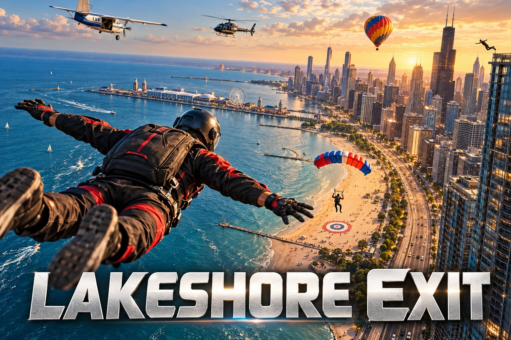

# Lakeshore Exit



<sub>Key art by James Keith Harwood. The cabin music on the ride up (`public/audio/cabin.mp3`) was supplied by James Keith Harwood.</sub>

First-person skydiving over the Chicago lakefront. Ride a Twin Otter east of the beach, walk to the door, and exit over Lake Michigan. Pull when you want. If the main fails, cut away and throw the reserve before the hard deck, then fly the canopy back to the sand.

**[▶ Play Lakeshore Exit](https://www.jameskeithharwood.com/games/lakeshore-exit/)** in your browser. On a phone, use "Add to Home Screen" to install it like an app.

## Run

```bash
npm install
npm run dev
```

The dev server listens on port 8080.

## Publish

`npm run build:web` builds a static, installable copy of the game into `dist-web/` (relative paths, so it works under any subpath). The repo is private, so the site is published by copying `dist-web/` into the `games/lakeshore-exit/` folder of `jkh2/jkh2.github.io`, which serves it at https://www.jameskeithharwood.com/games/lakeshore-exit/. CI builds the same output on every push (`.github/workflows/build-web.yml`). Runtime asset URLs in game code should start with `import.meta.env.BASE_URL`.

## Jump

- Exit altitude 8,000–20,000 ft. Malfunction chance 0–40%.
- Time of day: Midday, Golden hour or Dusk. At golden hour the sun sets behind the skyline; at dusk the windows, streets, Lake Shore Drive, Buckingham Fountain and the Navy Pier wheel light up. The presets live in `src/game/world.ts`.
- Cabin: mouse look, WASD to walk. The bar across the door lifts on the green light; run out the door to jump. The timer to green sits in the middle of the screen.
- Freefall: mouse is body attitude. A/D turn, W arches, S dives.
- Two jumpers leave just ahead of you and build a base with a slot open for you. Fly to the BASE marker and face in to dock. At 5,500 ft everyone breaks off: turn away, track, and get clear before you pull.
- A cumulus deck sits around 6,000 ft. You fall straight through it: the world goes white, then opens up below. Real jumpers keep clear of clouds; here you get to feel one.
- Canopy: A/D turn, W drives, S flares. Face the lake and land into the wind.
- Low under canopy your shadow shows on the ground ahead of you, the way real jumpers judge height on final.
- Every jump is scored out of 100 in the debrief: exit, dock, separation, pull altitude, heading, touchdown and accuracy. Your top score is kept.
- Audible altimeter and a full-screen banner at 4,500 ft. Pull-now at 3,000. Hard deck at 2,000.
- A bad main is a streamer or a line twist. Cut away, then deploy the reserve. Too low and you go in.

## Chicago

The lakefront is at true scale around the drop zone at 12th Street Beach. Willis Tower stands about 2.4 km to the northwest, the Hancock 4 km up the shore and Navy Pier reaches a kilometer into the lake 3 km north. Twenty-three landmark towers sit at their real latitude and longitude, measured from the lake edge because the game's shore is straight. Grant Park, Buckingham Fountain, the river and its branches, Monroe Harbor's moored boats, Museum Campus, Soldier Field and the Centennial Wheel are there too. Everything is drawn in code; `src/game/skyline.ts` holds the places and the heights.

The sky is busy too: airliners passing low and cruising high with contrails, light planes along the shore, a blimp lapping the lakefront, a banner plane over the beach, and now and then an air-show jet team that runs down the shore trailing smoke in the Chicago flag's colors and bursts over the beach. The jump replay gives the team its own shot. See `src/game/airshow.ts` and `src/game/life.ts`.

Best beach landing is saved in the browser.
